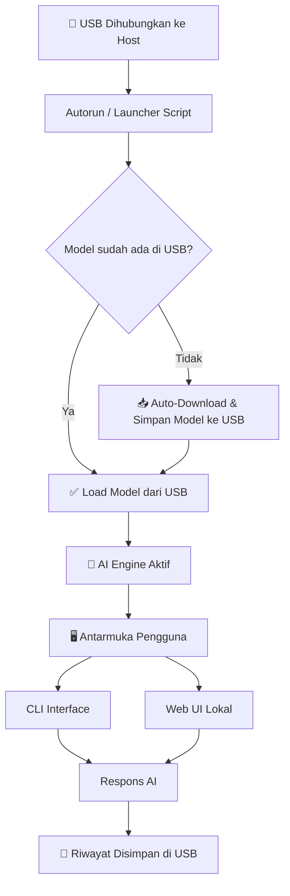
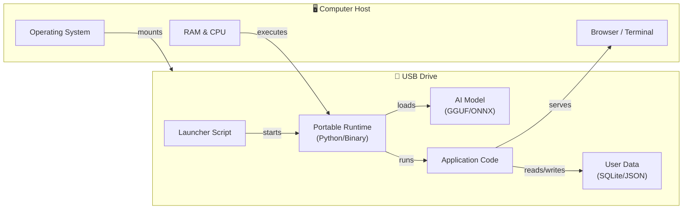
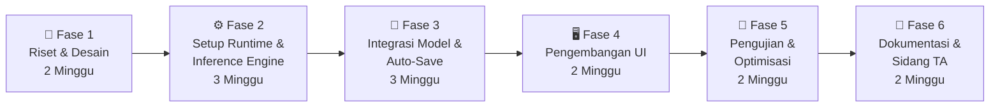

# 📋 Product Requirements Document (PRD)
## USB-Embedded Portable AI System

> **Proyek:** Tugas Akhir — Program Studi Informatika, Universitas Andalas
> **Versi:** 1.0.0 (Draft)
> **Tanggal:** 16 November 2026
> **Status:** 🟡 Draft — Menunggu Persetujuan

---

## 1. Ringkasan Eksekutif

### 1.1 Latar Belakang
Perkembangan model kecerdasan buatan (AI) terus mengalami kemajuan pesat, namun aksesibilitas dan portabilitasnya masih menjadi tantangan. Sebagian besar solusi AI modern bergantung pada koneksi internet dan server cloud yang tidak selalu tersedia. Proyek ini bertujuan membangun sebuah **sistem AI portabel yang tertanam sepenuhnya dalam perangkat USB**, sehingga dapat digunakan kapan saja dan di mana saja tanpa bergantung pada infrastruktur eksternal.

### 1.2 Visi Produk
> *"AI dalam genggaman — cerdas, portabel, dan selalu siap digunakan."*

Sebuah perangkat USB yang di dalamnya tertanam model AI ringan (*lightweight*), siap dijalankan langsung dari USB pada komputer mana pun tanpa instalasi tambahan.

### 1.3 Tujuan Strategis
| # | Tujuan | Metrik Keberhasilan |
|---|--------|---------------------|
| 1 | Portabilitas penuh | Berjalan di ≥3 OS berbeda (Windows, Linux, macOS) |
| 2 | Otomatisasi penyimpanan model ke USB | Model tersimpan & ter-update otomatis saat USB dihubungkan |
| 3 | Offline-first | Fungsi utama tidak memerlukan koneksi internet |
| 4 | Performa ringan | Model dapat berjalan pada RAM ≤4GB |

---

## 2. Ruang Lingkup Proyek

### 2.1 Dalam Ruang Lingkup (In Scope)
- ✅ Model AI ringan (LLM kecil / model khusus domain)
- ✅ Sistem auto-deploy: model otomatis disalin & dikonfigurasi ke USB saat pertama kali dihubungkan
- ✅ Runtime portable (Python embeddable / ONNX Runtime / llama.cpp)
- ✅ Antarmuka pengguna sederhana (CLI atau Web UI ringan)
- ✅ Mekanisme pembaruan model (opsional, via script)
- ✅ Enkripsi dan keamanan data di USB

### 2.2 Di Luar Ruang Lingkup (Out of Scope)
- ❌ Training model dari nol (model digunakan dari pre-trained)
- ❌ Aplikasi mobile
- ❌ Deployment ke cloud/server
- ❌ Multi-user authentication kompleks

---

## 3. Analisis Pemangku Kepentingan

### 3.1 Pengguna Target
| Segmen | Deskripsi | Kebutuhan Utama |
|--------|-----------|-----------------|
| **Mahasiswa** | Pengguna umum yang berpindah komputer | AI asisten belajar portabel |
| **Peneliti Lapangan** | Bekerja di area tanpa internet | AI untuk analisis data offline |
| **Profesional IT** | Butuh tool AI portable | Debugging, dokumentasi, scripting |
| **Institusi Pendidikan** | Distribusi AI ke siswa tanpa infrastruktur | Distribusi via USB massal |

### 3.2 Pemangku Kepentingan Proyek
- **Mahasiswa (Peneliti):** Pemilik dan pengembang sistem
- **Dosen Pembimbing:** Pemberi arahan teknis dan akademis
- **Dosen Penguji:** Evaluator akhir proyek
- **Pengguna Beta:** Rekan mahasiswa sebagai tester

---

## 4. Persyaratan Fungsional

### 4.1 Modul Utama



### 4.2 Fitur Wajib (Must Have)

#### F-01: Auto-Save Model ke USB
- Saat USB pertama kali dihubungkan ke host yang terhubung internet, sistem **secara otomatis mengunduh dan menyimpan** model AI ke direktori USB
- Format model: GGUF (llama.cpp) atau ONNX
- Progress unduhan ditampilkan ke pengguna
- Verifikasi integritas model via checksum (SHA256)

#### F-02: Portable Runtime
- Sistem dapat dijalankan **tanpa instalasi apapun** di komputer host
- Runtime dikemas bersama dalam USB (Python embeddable / binary standalone)
- Mendukung: Windows 10+, Ubuntu 20.04+, macOS 12+

#### F-03: Inference Engine Offline
- Model berjalan sepenuhnya secara lokal
- Mendukung input teks (prompt) dan menghasilkan respons teks
- Konfigurasi parameter inference: temperature, max tokens, context window

#### F-04: Antarmuka Pengguna
- **Mode CLI:** Interaksi langsung via terminal
- **Mode Web UI:** Server lokal ringan (port 7860 atau 8080) dengan antarmuka chat sederhana
- Riwayat percakapan disimpan di USB dalam format JSON/SQLite

#### F-05: Manajemen Model di USB
- Pengguna dapat melihat model yang tersimpan di USB
- Pengguna dapat menghapus / mengganti model
- Tersedia script pembaruan model ke versi terbaru

### 4.3 Fitur Opsional (Nice to Have)
- 🔵 Multi-model support (ganti model on-the-fly)
- 🔵 Plugin sistem (tambah kemampuan AI: OCR, speech-to-text)
- 🔵 Enkripsi end-to-end untuk riwayat percakapan
- 🔵 Sinkronisasi riwayat ke cloud (opsional, jika internet tersedia)

---

## 5. Persyaratan Non-Fungsional

### 5.1 Performa
| Metrik | Target |
|--------|--------|
| Waktu startup sistem | ≤ 10 detik |
| Waktu respons rata-rata (token pertama) | ≤ 5 detik |
| Ukuran total sistem di USB | ≤ 8 GB |
| RAM yang digunakan saat berjalan | ≤ 4 GB |
| Kecepatan USB minimum | USB 3.0 (5 Gbps) |

### 5.2 Keamanan
- Model dan data pengguna **tidak meninggalkan jejak** di komputer host
- Semua data sesi tersimpan di USB, bukan di host
- Opsional: enkripsi AES-256 untuk direktori data di USB

### 5.3 Ketersediaan & Reliabilitas
- Sistem harus mampu recover otomatis jika model rusak/korup (re-download)
- Toleransi kesalahan: jika model gagal dimuat, tampilkan pesan error yang jelas

### 5.4 Kompatibilitas
- Hardware: USB Type-A dan Type-C (dengan adapter)
- Kapasitas USB minimum: **32 GB**
- Kapasitas USB rekomendasi: **64 GB** atau lebih

---

## 6. Arsitektur Sistem

### 6.1 Struktur Direktori USB

```
📁 USB_AI/
├── 📁 runtime/          # Python embeddable / binary
│   ├── python/
│   └── libs/
├── 📁 models/           # Model AI (GGUF/ONNX)
│   └── model.gguf
├── 📁 app/              # Kode aplikasi utama
│   ├── main.py
│   ├── inference.py
│   ├── ui_cli.py
│   └── ui_web.py
├── 📁 data/             # Data pengguna (riwayat, config)
│   ├── history.db
│   └── config.json
├── 📁 scripts/          # Script utilitas
│   ├── setup.sh / setup.bat
│   ├── update_model.sh
│   └── launcher.sh / launcher.bat
└── 📄 README.md
```

### 6.2 Stack Teknologi (Rekomendasi)

| Komponen | Teknologi | Alasan |
|----------|-----------|--------|
| Inference Engine | **llama.cpp** / Ollama portable | Ringan, mendukung GGUF, CPU-friendly |
| Model | **Qwen2.5-1.5B-Instruct-GGUF** / Phi-3 Mini | Kecil, performa baik, offline |
| Runtime | **Python 3.11 Embeddable** | Portable, tanpa instalasi |
| Web UI | **Gradio** / Flask + React minimal | Ringan, mudah dikembangkan |
| Database | **SQLite** | File-based, tanpa server |
| Launcher | Bash script + Batch script | Cross-platform |

### 6.3 Diagram Komponen



---

## 7. Alur Pengguna (User Flow)

### 7.1 Setup Pertama Kali
```
1. Pengguna menghubungkan USB ke komputer (internet tersedia)
2. Jalankan launcher.bat (Windows) atau ./launcher.sh (Linux/Mac)
3. Sistem deteksi: model belum ada di USB
4. Sistem unduh model AI secara otomatis (progress bar ditampilkan)
5. Model tersimpan di USB/models/
6. Sistem siap → masuk ke antarmuka pengguna
```

### 7.2 Penggunaan Normal (Offline)
```
1. Pengguna menghubungkan USB ke komputer mana pun
2. Jalankan launcher
3. Sistem load model dari USB (tidak perlu internet)
4. Pengguna berinteraksi dengan AI via CLI atau Web UI
5. Riwayat otomatis tersimpan di USB
6. Cabut USB → tidak ada jejak di host
```

---

## 8. Rencana Pengujian

### 8.1 Unit Testing
- [ ] Verifikasi integritas model (checksum)
- [ ] Fungsi inference engine (respons valid)
- [ ] Read/write riwayat ke SQLite

### 8.2 Integration Testing
- [ ] Auto-download dan simpan model saat pertama kali dijalankan
- [ ] Launcher berjalan di Windows, Linux, macOS
- [ ] Web UI dapat diakses dari browser host

### 8.3 Performance Testing
- [ ] Waktu startup < 10 detik
- [ ] Token generation rate (tokens/sec) pada CPU target
- [ ] Penggunaan RAM saat berjalan

### 8.4 Security Testing
- [ ] Verifikasi tidak ada file tersisa di host setelah USB dicabut
- [ ] Verifikasi enkripsi data (jika diimplementasikan)

---

## 9. Rencana Pengembangan (Timeline)



| Fase | Aktivitas | Durasi | Output |
|------|-----------|--------|--------|
| **1** | Riset model ringan, desain arsitektur | 2 minggu | Dokumen desain |
| **2** | Setup portable runtime, test inference | 3 minggu | Runtime berjalan |
| **3** | Integrasi model, auto-save ke USB | 3 minggu | Core system |
| **4** | Pengembangan CLI & Web UI | 2 minggu | Antarmuka lengkap |
| **5** | Pengujian lintas platform, optimisasi | 2 minggu | Sistem stabil |
| **6** | Penulisan laporan TA, sidang | 2 minggu | Laporan & presentasi |

**Total Estimasi: ±14 Minggu (~3.5 Bulan)**

---

## 10. Risiko & Mitigasi

| Risiko | Dampak | Probabilitas | Mitigasi |
|--------|--------|-------------|----------|
| Model terlalu besar untuk USB | Tinggi | Sedang | Gunakan model kuantisasi (Q4_K_M) |
| Performa lambat di CPU lama | Tinggi | Tinggi | Batasi parameter, gunakan model <2B params |
| Launcher tidak kompatibel di semua OS | Sedang | Sedang | Test di 3 OS, buat launcher terpisah per OS |
| USB rusak / data korup | Tinggi | Rendah | Backup checksum, panduan recovery |
| Hak akses USB dibatasi admin | Sedang | Sedang | Jalankan dalam mode user, dokumentasikan workaround |

---

## 11. Kriteria Penerimaan (Acceptance Criteria)

Sistem dinyatakan **berhasil** jika memenuhi seluruh kriteria berikut:

- [x] ✅ Model AI dapat berjalan sepenuhnya dari USB tanpa instalasi di host
- [x] ✅ Model otomatis diunduh dan disimpan ke USB pada penggunaan pertama
- [x] ✅ Sistem berjalan di minimal 2 sistem operasi berbeda
- [x] ✅ Waktu startup ≤ 10 detik
- [x] ✅ Tidak ada data tertinggal di komputer host setelah USB dicabut
- [x] ✅ Riwayat percakapan tersimpan di USB dan dapat diakses kembali

---

## 12. Referensi & Pustaka Relevan

- [llama.cpp](https://github.com/ggerganov/llama.cpp) — Inference engine ringan untuk model GGUF
- [Ollama](https://ollama.ai) — Runtime model AI lokal
- [Hugging Face GGUF Models](https://huggingface.co/models?library=gguf) — Repository model
- [Python Embeddable](https://www.python.org/downloads/windows/) — Runtime Python portable
- Qwen2.5 / Phi-3 Mini / TinyLlama — Kandidat model AI ringan

---

*Dokumen ini merupakan living document yang akan diperbarui seiring perkembangan proyek.*
*Dibuat untuk keperluan Tugas Akhir — Informatika, Universitas Andalas.*
