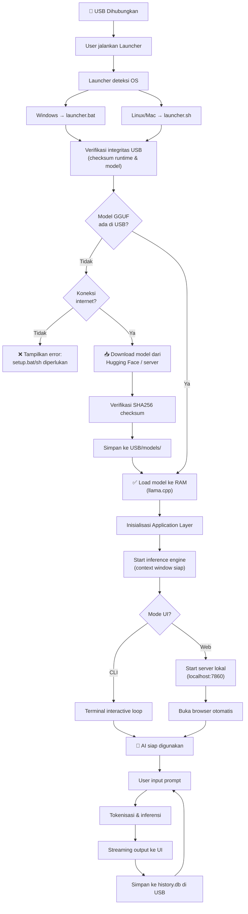
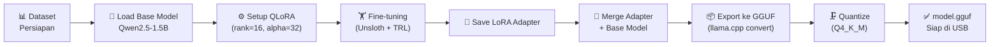
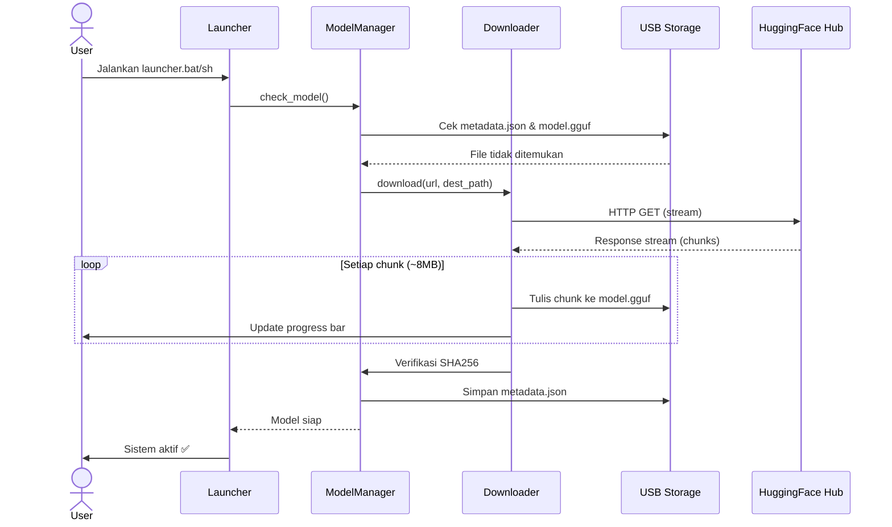
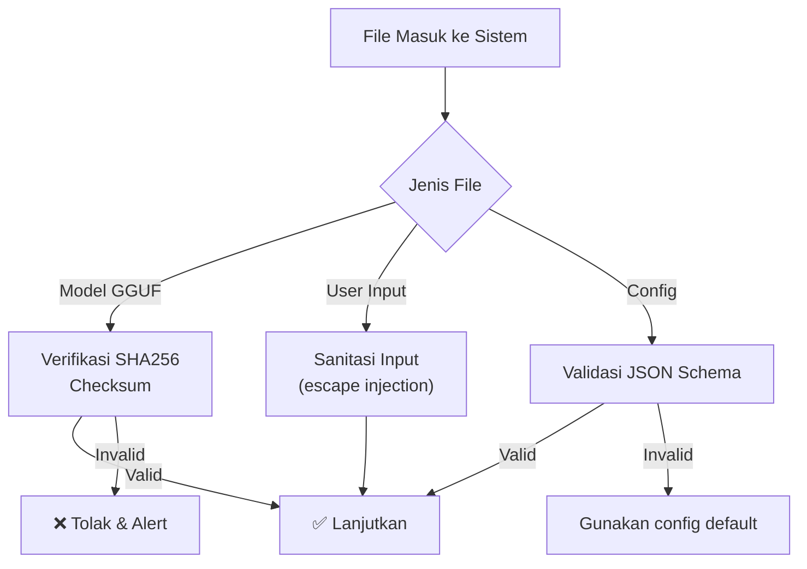

# 🏗️ Desain Arsitektur Teknis
## USB-Embedded Portable AI System

> **Versi:** 1.0.0
> **Tanggal:** 17 November 2026
> **Status:** 🟡 Draft

---

## 1. Gambaran Umum Arsitektur

Sistem ini dirancang dengan prinsip **"Self-Contained USB Artifact"** — seluruh komponen (runtime, model, aplikasi, dan data) hidup di dalam USB dan tidak bergantung pada perangkat lunak yang terinstal di komputer host.

### 1.1 Prinsip Desain

| Prinsip | Penjelasan |
|---------|------------|
| **Portability-first** | Semua dependensi dikemas dalam USB |
| **Offline-first** | Inferensi berjalan tanpa internet |
| **Zero-install** | Tidak ada yang diinstal di host |
| **Zero-trace** | Tidak ada jejak data di host setelah USB dicabut |
| **Modular** | Setiap komponen dapat diganti secara independen |

---

## 2. Diagram Arsitektur Sistem

### 2.1 Arsitektur High-Level

```
┌─────────────────────────────────────────────────────────────┐
│                     COMPUTER HOST                           │
│                                                             │
│   ┌─────────┐    ┌──────────────────────────────────────┐  │
│   │   OS    │    │           USB DRIVE                  │  │
│   │(Win/Lin/│◄──►│                                      │  │
│   │  Mac)   │    │  ┌────────────┐  ┌────────────────┐  │  │
│   └────┬────┘    │  │  Launcher  │  │ Portable Python│  │  │
│        │         │  │  (.bat/.sh)│─►│   Runtime      │  │  │
│   ┌────▼────┐    │  └────────────┘  └───────┬────────┘  │  │
│   │  RAM &  │◄───│                          │           │  │
│   │   CPU   │    │  ┌───────────────────────▼─────────┐ │  │
│   └─────────┘    │  │       APPLICATION LAYER         │ │  │
│                  │  │  ┌──────────┐  ┌─────────────┐  │ │  │
│   ┌─────────┐    │  │  │  CLI UI  │  │  Web UI     │  │ │  │
│   │ Browser │◄───│  │  │          │  │  (Gradio)   │  │ │  │
│   │(Web UI) │    │  │  └────┬─────┘  └──────┬──────┘  │ │  │
│   └─────────┘    │  │       └───────┬────────┘         │ │  │
│                  │  │  ┌────────────▼────────────────┐ │ │  │
│   ┌─────────┐    │  │  │      INFERENCE ENGINE       │ │ │  │
│   │Terminal │◄───│  │  │      (llama.cpp / ctransf.) │ │ │  │
│   │  (CLI)  │    │  │  └────────────┬────────────────┘ │ │  │
│   └─────────┘    │  │               │                   │ │  │
│                  │  │  ┌────────────▼────────────────┐ │ │  │
│                  │  │  │      MODEL LAYER            │ │ │  │
│                  │  │  │  model.gguf (Q4_K_M)        │ │ │  │
│                  │  │  └─────────────────────────────┘ │ │  │
│                  │  │                                   │ │  │
│                  │  │  ┌─────────────────────────────┐ │ │  │
│                  │  │  │      DATA LAYER             │ │ │  │
│                  │  │  │  history.db  config.json    │ │ │  │
│                  │  │  └─────────────────────────────┘ │ │  │
│                  │  └───────────────────────────────────┘ │  │
│                  └──────────────────────────────────────┘  │
└─────────────────────────────────────────────────────────────┘
```

### 2.2 Alur Eksekusi Sistem



---

## 3. Layer-by-Layer Design

### 3.1 Layer 1 — Launcher Layer

**Fungsi:** Entry point sistem, deteksi OS, dan bootstrap runtime.

```
scripts/
├── launcher.bat          # Windows entry point
├── launcher.sh           # Linux/macOS entry point
├── setup.bat             # First-time setup (Windows)
└── setup.sh              # First-time setup (Linux/macOS)
```

**Pseudocode launcher.bat:**
```batch
@echo off
SET USB_ROOT=%~dp0
SET PYTHON=%USB_ROOT%runtime\python\python.exe
SET APP=%USB_ROOT%app\main.py

:: Cek apakah runtime ada
IF NOT EXIST "%PYTHON%" (
    echo [ERROR] Runtime tidak ditemukan. Jalankan setup.bat terlebih dahulu.
    pause & exit /b 1
)

:: Jalankan aplikasi
"%PYTHON%" "%APP%" %*
```

**Pseudocode launcher.sh:**
```bash
#!/bin/bash
USB_ROOT="$(cd "$(dirname "$0")" && pwd)"
PYTHON="$USB_ROOT/runtime/python/bin/python3"
APP="$USB_ROOT/app/main.py"

# Deteksi OS
OS="$(uname -s)"
case "$OS" in
    Linux*)  PLATFORM="linux" ;;
    Darwin*) PLATFORM="macos" ;;
    *)       echo "[ERROR] OS tidak didukung"; exit 1 ;;
esac

"$PYTHON" "$APP" "$@"
```

---

### 3.2 Layer 2 — Portable Runtime Layer

**Fungsi:** Menyediakan interpreter Python dan semua library yang diperlukan, tanpa instalasi di host.

**Komponen:**
```
runtime/
├── python/                    # Python 3.11 Embeddable (Windows)
│   ├── python.exe
│   ├── python311.dll
│   └── Lib/
│       └── site-packages/
│           ├── llama_cpp/     # llama-cpp-python (pre-compiled)
│           ├── gradio/        # Web UI framework
│           ├── rich/          # Terminal formatting
│           └── ...
├── linux/                     # Binary untuk Linux (opsional)
│   └── python3
└── macos/                     # Binary untuk macOS (opsional)
    └── python3
```

**Library yang diperlukan:**

| Library | Versi | Fungsi |
|---------|-------|--------|
| `llama-cpp-python` | ≥0.2.90 | Wrapper Python untuk llama.cpp |
| `gradio` | ≥4.0 | Web UI framework |
| `rich` | ≥13.0 | Terminal formatting & progress bar |
| `click` | ≥8.0 | CLI argument parsing |
| `sqlite3` | built-in | Database riwayat |
| `hashlib` | built-in | Checksum verifikasi |
| `requests` | ≥2.31 | Download model |

---

### 3.3 Layer 3 — Application Layer

**Fungsi:** Logika utama aplikasi — routing UI, session management, dan orkestrasi komponen.

```
app/
├── main.py               # Entry point aplikasi
├── config.py             # Konfigurasi global
├── inference.py          # Inference engine wrapper
├── model_manager.py      # Manajemen download & load model
├── history.py            # Manajemen riwayat percakapan
├── ui/
│   ├── __init__.py
│   ├── cli.py            # CLI interface
│   └── web.py            # Web UI (Gradio)
└── utils/
    ├── __init__.py
    ├── checksum.py       # Verifikasi integritas file
    ├── downloader.py     # Download model dengan progress
    └── logger.py         # Logging sistem
```

**main.py — Alur utama:**
```python
# Pseudocode
def main():
    config = load_config()           # Baca config.json dari USB
    model_manager = ModelManager(config)

    # Pastikan model tersedia
    if not model_manager.model_exists():
        model_manager.download_model()   # Auto-download jika belum ada

    # Load model ke memori
    engine = InferenceEngine(model_manager.get_model_path(), config)
    engine.load()

    # Pilih UI berdasarkan argumen
    if config.ui_mode == "web":
        WebUI(engine).launch()
    else:
        CLI(engine).run()
```

---

### 3.4 Layer 4 — Inference Engine Layer

**Fungsi:** Menjalankan inferensi model AI menggunakan llama.cpp.

**inference.py:**
```python
# Pseudocode
class InferenceEngine:
    def __init__(self, model_path: str, config: Config):
        self.model_path = model_path
        self.config = config
        self.llm = None

    def load(self):
        from llama_cpp import Llama
        self.llm = Llama(
            model_path=self.model_path,
            n_ctx=self.config.context_window,    # default: 2048
            n_threads=self.config.cpu_threads,   # default: 4
            n_gpu_layers=0,                       # CPU-only
            verbose=False
        )

    def generate(self, prompt: str, stream: bool = True):
        formatted = self._format_prompt(prompt)
        output = self.llm(
            formatted,
            max_tokens=self.config.max_tokens,   # default: 512
            temperature=self.config.temperature, # default: 0.7
            stream=stream
        )
        if stream:
            for chunk in output:
                yield chunk["choices"][0]["text"]
        else:
            return output["choices"][0]["text"]

    def _format_prompt(self, user_input: str) -> str:
        # Format sesuai template model (ChatML / Alpaca / dll)
        return f"<|im_start|>user\n{user_input}<|im_end|>\n<|im_start|>assistant\n"
```

**Parameter Inferensi:**

| Parameter | Default | Range | Keterangan |
|-----------|---------|-------|------------|
| `n_ctx` | 2048 | 512–4096 | Panjang context window |
| `temperature` | 0.7 | 0.0–1.0 | Kreativitas respons |
| `max_tokens` | 512 | 64–2048 | Panjang maksimal respons |
| `n_threads` | 4 | 1–8 | Thread CPU yang digunakan |
| `top_p` | 0.95 | 0.0–1.0 | Nucleus sampling |
| `repeat_penalty` | 1.1 | 1.0–1.5 | Penalti pengulangan kata |

---

### 3.5 Layer 5 — Model Layer

**Fungsi:** Menyimpan dan mengelola model AI dalam format GGUF.

```
models/
├── model.gguf               # Model aktif (symlink atau file langsung)
├── metadata.json            # Informasi model (nama, versi, checksum)
└── cache/                   # Cache tokenizer (opsional)
```

**metadata.json:**
```json
{
  "model_name": "usb-ai-v1",
  "base_model": "Qwen2.5-1.5B-Instruct",
  "fine_tuned": true,
  "quantization": "Q4_K_M",
  "size_bytes": 1073741824,
  "sha256": "abc123...",
  "download_url": "https://huggingface.co/...",
  "created_at": "2026-11-17",
  "context_length": 4096,
  "languages": ["id", "en"]
}
```

**Kandidat Model:**

| Model | Parameter | GGUF Size (Q4) | RAM Usage | Kualitas |
|-------|-----------|----------------|-----------|----------|
| **Qwen2.5-1.5B-Instruct** | 1.5B | ~1.0 GB | ~1.5 GB | ⭐⭐⭐⭐ |
| **Phi-3 Mini 3.8B** | 3.8B | ~2.4 GB | ~3.0 GB | ⭐⭐⭐⭐⭐ |
| TinyLlama 1.1B | 1.1B | ~0.7 GB | ~1.2 GB | ⭐⭐⭐ |
| Llama 3.2 1B | 1.0B | ~0.7 GB | ~1.2 GB | ⭐⭐⭐⭐ |

> ✅ **Rekomendasi:** Qwen2.5-1.5B-Instruct (dukungan Bahasa Indonesia lebih baik)

---

### 3.6 Layer 6 — UI Layer

**Fungsi:** Antarmuka interaksi pengguna dalam dua mode.

#### Mode CLI

```
┌─────────────────────────────────────────┐
│  🤖 USB AI System v1.0.0               │
│  Model: usb-ai-v1 (Q4_K_M)            │
│  Status: Ready | RAM: 1.4GB used       │
├─────────────────────────────────────────┤
│                                         │
│  You: Jelaskan apa itu machine learning │
│                                         │
│  AI: Machine learning adalah...         │
│      [streaming output...]              │
│                                         │
├─────────────────────────────────────────┤
│  [/help] [/clear] [/history] [/exit]   │
└─────────────────────────────────────────┘
```

**Command CLI:**
| Command | Fungsi |
|---------|--------|
| `/help` | Tampilkan bantuan |
| `/clear` | Bersihkan layar & reset sesi |
| `/history` | Tampilkan riwayat percakapan |
| `/save` | Simpan sesi saat ini ke USB |
| `/config` | Lihat/ubah konfigurasi |
| `/exit` | Keluar dari aplikasi |

#### Mode Web UI (Gradio)

```
┌──────────────────────────────────────────────────────┐
│  🤖 USB AI System          localhost:7860            │
├──────────────────────────────────────────────────────┤
│                                                      │
│  ┌────────────────────────────────────────────────┐  │
│  │                                                │  │
│  │  AI: Halo! Saya adalah USB AI Assistant.      │  │
│  │      Ada yang bisa saya bantu?                │  │
│  │                                                │  │
│  │  You: Apa itu deep learning?                  │  │
│  │                                                │  │
│  │  AI: Deep learning adalah...                  │  │
│  │      [streaming response...]                  │  │
│  │                                                │  │
│  └────────────────────────────────────────────────┘  │
│                                                      │
│  ┌──────────────────────────────────┐  ┌──────────┐  │
│  │  Ketik pesan di sini...          │  │  Kirim   │  │
│  └──────────────────────────────────┘  └──────────┘  │
│                                                      │
│  [🗑️ Clear]  [💾 Save]  [⚙️ Settings]              │
└──────────────────────────────────────────────────────┘
```

---

### 3.7 Layer 7 — Data Layer

**Fungsi:** Persistensi data pengguna sepenuhnya di USB.

**Skema Database SQLite (`history.db`):**

```sql
-- Tabel sesi percakapan
CREATE TABLE sessions (
    id          INTEGER PRIMARY KEY AUTOINCREMENT,
    created_at  DATETIME DEFAULT CURRENT_TIMESTAMP,
    title       TEXT,
    model_name  TEXT
);

-- Tabel pesan
CREATE TABLE messages (
    id          INTEGER PRIMARY KEY AUTOINCREMENT,
    session_id  INTEGER REFERENCES sessions(id),
    role        TEXT CHECK(role IN ('user', 'assistant', 'system')),
    content     TEXT NOT NULL,
    created_at  DATETIME DEFAULT CURRENT_TIMESTAMP,
    tokens_used INTEGER
);

-- Tabel konfigurasi pengguna
CREATE TABLE user_config (
    key         TEXT PRIMARY KEY,
    value       TEXT,
    updated_at  DATETIME DEFAULT CURRENT_TIMESTAMP
);
```

**config.json:**
```json
{
  "ui_mode": "cli",
  "language": "id",
  "model": {
    "path": "models/model.gguf",
    "context_window": 2048,
    "max_tokens": 512,
    "temperature": 0.7,
    "top_p": 0.95,
    "repeat_penalty": 1.1,
    "cpu_threads": 4
  },
  "system_prompt": "Kamu adalah asisten AI yang membantu dan ramah. Jawab dalam Bahasa Indonesia.",
  "auto_save_history": true,
  "web_port": 7860
}
```

---

## 4. Pipeline Fine-tuning Model

### 4.1 Alur Fine-tuning (Google Colab / Kaggle)



### 4.2 Spesifikasi Fine-tuning

| Parameter | Nilai |
|-----------|-------|
| Base Model | `Qwen/Qwen2.5-1.5B-Instruct` |
| Framework | Unsloth + HuggingFace TRL |
| Metode | QLoRA (Quantized Low-Rank Adaptation) |
| LoRA Rank | 16 |
| LoRA Alpha | 32 |
| Batch Size | 2 (Colab GPU limit) |
| Learning Rate | 2e-4 |
| Epochs | 3 |
| Max Seq Length | 2048 |
| GPU Target | T4 / A100 (Google Colab) |
| Output Format | GGUF Q4_K_M |

### 4.3 Format Dataset (JSONL)

```jsonl
{"messages": [{"role": "user", "content": "Apa itu machine learning?"}, {"role": "assistant", "content": "Machine learning adalah cabang dari kecerdasan buatan..."}]}
{"messages": [{"role": "user", "content": "Bagaimana cara kerja neural network?"}, {"role": "assistant", "content": "Neural network bekerja dengan meniru cara kerja otak manusia..."}]}
```

---

## 5. Mekanisme Auto-Save Model ke USB

### 5.1 Flow Diagram



### 5.2 Implementasi Downloader

```python
# Pseudocode downloader.py
import requests
import hashlib
from rich.progress import Progress

def download_model(url: str, dest_path: str, expected_sha256: str):
    response = requests.get(url, stream=True)
    total_size = int(response.headers.get('content-length', 0))
    sha256 = hashlib.sha256()

    with Progress() as progress:
        task = progress.add_task("[cyan]Downloading model...", total=total_size)

        with open(dest_path, 'wb') as f:
            for chunk in response.iter_content(chunk_size=8 * 1024 * 1024):  # 8MB
                f.write(chunk)
                sha256.update(chunk)
                progress.update(task, advance=len(chunk))

    # Verifikasi integritas
    if sha256.hexdigest() != expected_sha256:
        os.remove(dest_path)
        raise ValueError("❌ Checksum tidak cocok! File korup.")

    print("✅ Model berhasil diunduh dan diverifikasi.")
```

---

## 6. Keamanan Sistem

### 6.1 Zero-Trace Architecture

Sistem dirancang agar tidak meninggalkan jejak di komputer host:

| Komponen | Lokasi Penyimpanan | Host Tersentuh? |
|----------|-------------------|-----------------|
| Model GGUF | USB/models/ | ❌ Tidak |
| Riwayat chat | USB/data/history.db | ❌ Tidak |
| Konfigurasi | USB/data/config.json | ❌ Tidak |
| Temporary files | USB/data/tmp/ | ❌ Tidak |
| Log aplikasi | USB/data/logs/ | ❌ Tidak |
| Python cache | USB/runtime/.cache/ | ❌ Tidak |

### 6.2 Mekanisme Keamanan



---

## 7. Kompatibilitas Platform

### 7.1 Matriks Kompatibilitas

| Komponen | Windows 10/11 | Ubuntu 20.04+ | macOS 12+ |
|----------|:---:|:---:|:---:|
| Launcher script | ✅ `.bat` | ✅ `.sh` | ✅ `.sh` |
| Python embeddable | ✅ | ⚠️ System Python | ⚠️ System Python |
| llama.cpp binary | ✅ `.dll` | ✅ `.so` | ✅ `.dylib` |
| SQLite | ✅ built-in | ✅ built-in | ✅ built-in |
| Web UI (Gradio) | ✅ | ✅ | ✅ |
| Auto-open browser | ✅ | ✅ | ✅ |

> ⚠️ Untuk Linux dan macOS, pengguna perlu memiliki Python 3.11+ terinstal di sistem, atau kita sediakan binary standalone via PyInstaller.

### 7.2 Strategi Cross-Platform Runtime

```
Opsi A (Recommended untuk TA):
  - Windows: Python Embeddable (fully portable)
  - Linux/macOS: PyInstaller-compiled binary

Opsi B (Simpler):
  - Semua OS: Require Python 3.11+ dari sistem
  - Setup script install dependensi ke virtualenv di USB
```

---

## 8. Estimasi Ukuran USB

| Komponen | Ukuran |
|----------|--------|
| Python Runtime (Windows embeddable + libs) | ~300 MB |
| llama.cpp binary (semua OS) | ~50 MB |
| Model GGUF (Qwen2.5-1.5B Q4_K_M) | ~1.0 GB |
| Aplikasi (kode Python) | ~5 MB |
| Data pengguna (riwayat) | ~10 MB (tumbuh) |
| **Total** | **~1.4 GB** |
| **Buffer & overhead** | ~0.6 GB |
| **Minimum USB** | **≥ 4 GB** (rekomendasi: **16 GB+**) |

---

## 9. Teknologi & Versi yang Digunakan

| Teknologi | Versi | Link |
|-----------|-------|------|
| Python | 3.11.x | [python.org](https://python.org) |
| llama-cpp-python | ≥0.2.90 | [GitHub](https://github.com/abetlen/llama-cpp-python) |
| Gradio | ≥4.44 | [gradio.app](https://gradio.app) |
| Unsloth (fine-tuning) | latest | [GitHub](https://github.com/unslothai/unsloth) |
| TRL (fine-tuning) | ≥0.11 | [GitHub](https://github.com/huggingface/trl) |
| Rich | ≥13.0 | [PyPI](https://pypi.org/project/rich) |
| Qwen2.5-1.5B-Instruct | latest | [HuggingFace](https://huggingface.co/Qwen) |

---

## 10. Referensi Arsitektur

- [llama.cpp Documentation](https://github.com/ggerganov/llama.cpp)
- [Python Embeddable Package](https://docs.python.org/3/using/windows.html#the-embeddable-package)
- [Unsloth Fine-tuning Guide](https://github.com/unslothai/unsloth)
- [GGUF Format Specification](https://github.com/ggerganov/ggml/blob/master/docs/gguf.md)
- [Gradio Documentation](https://www.gradio.app/docs)

---

*Dokumen ini merupakan living document yang akan diperbarui seiring perkembangan implementasi.*

